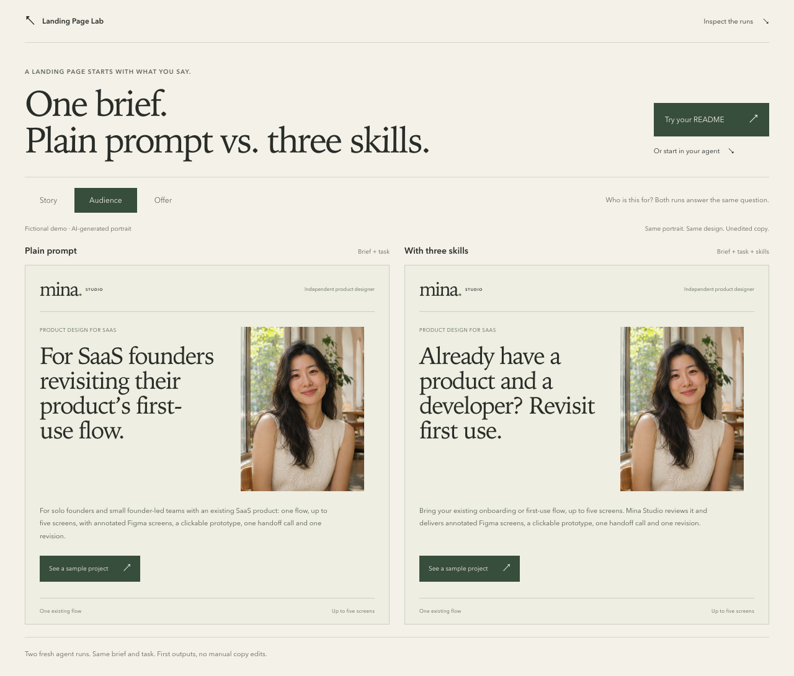

# Landing Page Lab

**Give your coding agent a marketing department.**

Three open-source agent skills take your product README into landing-page
directions, copy, and a build handoff: **the story, the audience, and the offer**.

Created by [Jazz](https://github.com/soohanjazzyun) for solo founders and developers
building products with AI.

```sh
npx skills add soohanjazzyun/landing-page-lab
```

[](https://soohanjazzyun.github.io/landing-page-lab/compare/)

[Compare plain prompt vs. three skills](https://soohanjazzyun.github.io/landing-page-lab/compare/) ·
[Try it on your README](https://soohanjazzyun.github.io/landing-page-lab/#workbench) ·
[Watch the 14-second proof clip](assets/mina-studio-proof.mp4) ·
[Inspect actual independent runs](docs/evaluation.md)

Two fresh agent runs. Same brief and task. First outputs, no manual copy edits.
Switch Story, Audience, and Offer to inspect every option in both records.
The service is fictional and the portrait is AI-generated. This pair shows
different choices, not a measured winner. [Brief, task, and both outputs](docs/evaluation/paired-mina/README.md).

Your agent can build the page. Give it a useful way to decide what that page
should say, using the facts you actually have.

## Try one hero first

After installing all three skills, give your coding agent this small task:

```text
Use landing-page-story, landing-page-resonance, and landing-page-offer
to propose three hero directions from my README.
For each, return one headline, one sentence, and my existing CTA.
Keep the product facts. Mark missing evidence. Explain one tradeoff.
Source: [paste my README]
```

## Pick the problem

| Skill | The question it helps answer | Use it when |
| --- | --- | --- |
| [`landing-page-story`](skills/landing-page-story/SKILL.md) | Can someone explain what this product does and why it helps? | Your homepage reads like a feature list or a company introduction. |
| [`landing-page-resonance`](skills/landing-page-resonance/SKILL.md) | Will a specific person recognize that this is for them? | Your page addresses everyone and gives nobody a reason to care. |
| [`landing-page-offer`](skills/landing-page-offer/SKILL.md) | Is the outcome credible and the next step worth the effort? | Benefits sound attractive, but the deliverable, evidence, or commitment is unclear. |

These are original workflows informed by published ideas from Donald Miller,
Seth Godin, and Alex Hormozi. They do not impersonate the authors or reproduce
an official course. Independent project; no affiliation or endorsement.
[Credits and boundaries](NOTICE.md) · [Rights review and limitations](docs/rights-review.md).

## Installation options

The command above lets you choose your agent and skills. To install one directly:

```sh
npx skills add soohanjazzyun/landing-page-lab --skill landing-page-story
```

Then give your coding agent a task:

```text
Use landing-page-story, landing-page-resonance, and landing-page-offer
on this product README. Return three distinct homepage directions from the
same facts. Explain the tradeoffs, preserve my stack and primary CTA,
and mark anything that needs evidence. Source: [attach your README]
```

Or keep the work narrow:

```text
Use landing-page-resonance to rewrite only this homepage hero for solo
consultants. Keep the product facts, design, and CTA. Source: [attach copy]
```

The skills are plain text in the Agent Skills format. Codex discovery and
installation are verified locally; other compatible assistants have not been
separately behavior-tested. No hosted model, API key, or account is provided
or required by this project. Your chosen agent may have its own requirements.

The repository and interactive demo are public. A clean remote installation
of all three skills into Codex has been verified. To install a local checkout,
run this from your own product's project folder:

```sh
npx skills add /path/to/landing-page-lab --agent codex --copy
```

Individual portable ZIPs and a full three-skill bundle are in `site/downloads/`.

Browse on skills.sh: [Story](https://www.skills.sh/soohanjazzyun/landing-page-lab/landing-page-story) · [Audience](https://www.skills.sh/soohanjazzyun/landing-page-lab/landing-page-resonance) · [Offer](https://www.skills.sh/soohanjazzyun/landing-page-lab/landing-page-offer).

## See the difference

The demo holds product facts and visual design constant while you switch
between **Before, Story, Audience, and Offer**. Inspect the reasoning,
page structure, copy, and implementation handoff for each direction.

| Fictional product | What it actually does |
| --- | --- |
| [RelayNote](examples/relaynote/README.md) | Organizes customer-call notes and links excerpts back to their source. |
| [ShipWatch](examples/shipwatch/README.md) | Shows when scheduled jobs miss a heartbeat; it does not retry the jobs. |
| [Slotwise](examples/slotwise/README.md) | Lets clients choose available appointment slots in their time zone. |

The three examples above are **authored illustrations**. The
[paired Mina comparison](https://soohanjazzyun.github.io/landing-page-lab/compare/)
renders two actual runs on the same fictional brief and task. The earlier
[single-run Mina case](https://soohanjazzyun.github.io/landing-page-lab/cases/mina-studio/)
is the source of the 14-second clip. These are separate recorded tasks, not
customer results, conversion experiments, or model benchmarks. Their records
and limitations are documented in [evaluation](docs/evaluation.md).

The local prompt composer prepares a task for your agent. It does not analyze
your product with a model, upload your README, or generate marketing copy itself.

## What you get

- A factual basis, assumptions, and proof gaps.
- A distinct direction with a reason to use it and a tradeoff.
- Page structure and English copy appropriate to your request.
- A build handoff that preserves your chosen stack, CTA, and design constraints.

A request for a hero stays a hero. A missing testimonial stays missing.
A persuasive offer does not justify inventing a guarantee, discount, integration,
customer count, or time saving.

## Prepare a portable task locally

Node.js 22+ is needed only for the optional helper scripts. The skills themselves
have no runtime dependency.

```sh
node scripts/brief.mjs \
  --source examples/shipwatch/README.md \
  --lens all \
  --stack "HTML and CSS" \
  --output .local/shipwatch-task.md
```

Use `--lens story`, `--lens resonance`, or `--lens offer` for one perspective;
use `--mode audit` for an existing page. The generated task includes the selected
instructions, supporting guidance, and your unchanged source. It calls no model
and refuses to overwrite an existing output file.

## Run the demo and checks

```sh
npm install
npm run dev
# Open http://127.0.0.1:4173
```

For development verification:

```sh
npx playwright install chromium
npm run check
npm run verify:cases
npm test
npm run test:browser
npm run test:package
npm run package
```

Packaging produces three individual skill ZIPs, the complete `landing-page-lab.zip`,
a static site in `dist/site`, and SHA-256 checksums. It uses the system `zip`
command, available on macOS, Linux, and WSL. Browser checks cover interaction,
local task preparation, downloads, mobile overflow, and automated accessibility.
These checks do not establish improved conversion rates.

## One Product, Three Pitches

Have a public product whose homepage is hard to explain? Submit it through the
[Homepage Clinic](https://github.com/soohanjazzyun/landing-page-lab/issues/new?template=homepage-clinic.yml). Share only material
you have permission to make public. A submission does not guarantee a review;
publication of a case study requires separate consent.

Useful failure reports include the source brief, selected skill, resulting copy,
and the decision that went wrong. See [contributing](CONTRIBUTING.md).

If this helps you explain your product, **star the repository** to follow the
next cases and improvements.

## License

Original project code and instructions: [MIT](LICENSE).
Third-party books, websites, graphics, and brands are not relicensed.
See [NOTICE](NOTICE.md) and [the rights review](docs/rights-review.md).
